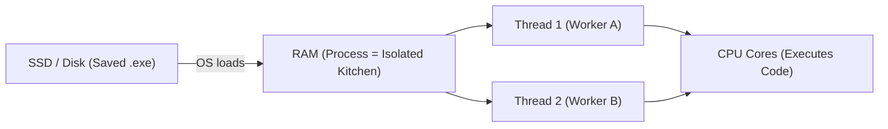
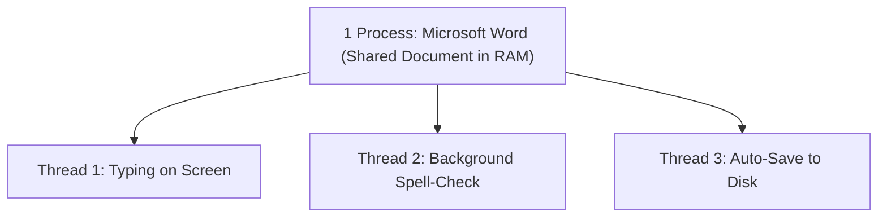
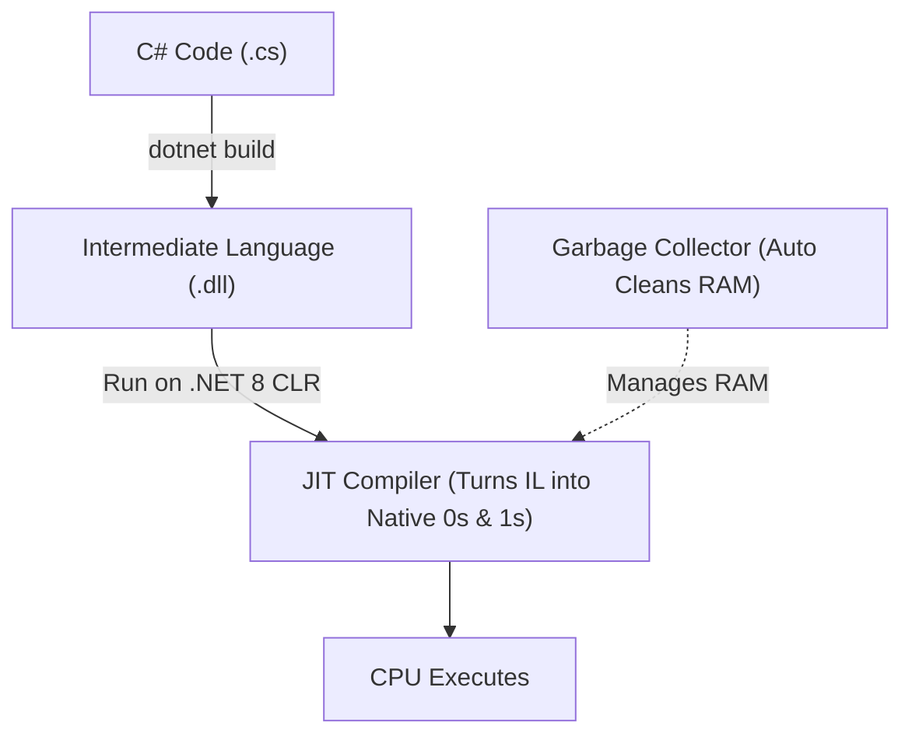

# 🚀 Day 01 — Dev Environment, Linux CLI & How Computers Run Code

**Date:** Thu, Nov 26, 2026 | **Phase 01 · Sprint 01** | **Duration:** 6 Hours | **Status:** ✅ Completed

---

## 🗺️ Today's Flow
- [x] **Step 1:** CPU, RAM, OS Processes & Threads
- [x] **Step 2:** How C# (.NET 8 CLR + JIT + GC) Runs vs C
- [x] **Step 3:** Verify & Install VS Code + .NET 8 SDK
- [x] **Step 4:** Linux Essential CLI Commands (`pwd`, `ls`, `cd`, `mkdir`, `grep`, `chmod`, `ps`, `top`)
- [x] **Step 5:** Build & Run First .NET 8 C# Console App (`PID` & `CPU Cores`)
- [x] **Step 6:** End-of-Day GitHub Push (`Day 01 notes` + Green Square)

---

## 🧠 Step 1: CPU, RAM, OS Processes & Threads

**Mental Model (Restaurant Kitchen Analogy):**
- **SSD / Disk** = Storage Room (slow, permanent — stores saved `.cs` / `.exe` files).
- **RAM (Memory)** = Kitchen Countertop (fast, temporary — OS loads running programs here).
- **CPU** = The Chef (executes instructions billions of times per second).
- **Process** = One running program with its own **isolated RAM space** (e.g., VS Code and Chrome are 2 separate Processes).
- **Thread** = A lightweight worker **inside a Process** sharing its RAM so multiple tasks run smoothly at once (e.g., typing + spell-check + auto-save inside Microsoft Word).





> **🎤 Interview Summary:** "A **process** is a running program with its own isolated memory space, while a **thread** is a lightweight unit of execution inside a process that shares that memory with other threads."

**✅ Step 1 Q&A:**
- **Q1:** If VS Code and Chrome are both open on your laptop, are they 2 Processes or 2 Threads?
  - **A1:** **2 separate Processes**, because each running application gets its own isolated memory space in RAM.
- **Q2:** Inside Chrome, playing a YouTube video while downloading a PDF at the same time — Processes or Threads?
  - **A2:** **Multiple Threads**, because they are separate workers running concurrently inside the same app, sharing its memory.

---

## ⚙️ Step 2: How C# (.NET 8 CLR) Runs Your Code vs C

CPUs only understand raw **`0`s and `1`s (Native Machine Code)**.
- **C** compiles directly to Native Machine Code (fast, manual memory management).
- **C# (.NET 8)** compiles in 2 steps: **Source Code → IL (`.dll`) → .NET CLR + JIT Compiler → Native Machine Code**, with automatic **Garbage Collection (GC)**.

| Term | Simple Meaning | Analogy |
| :--- | :--- | :--- |
| **`dotnet build`** | Checks C# code for errors and compiles it into a `.dll` file. | Burning a movie onto a DVD. |
| **IL (`.dll` file)** | Universal intermediate code (works across Windows, Linux, Mac). | The DVD disc. |
| **`.NET CLR`** | Common Language Runtime — the engine managing execution, GC, Threads & Exceptions. | The DVD Player. |
| **Native Machine Code** | Raw binary (`0`s & `1`s) executed directly by the CPU hardware. | Electrical signal to the TV. |
| **JIT Compiler** | Live translator inside the CLR that converts IL into Native Machine Code at runtime. | Chip translating DVD data to TV signal. |



> **🎤 Interview Summary:** "C# compiles into Intermediate Language (IL), and at runtime the .NET CLR's JIT compiler converts it into native machine code while the Garbage Collector automatically manages memory."

**✅ Step 2 Q&A:**
- **Q1:** What is Native Machine Code?
  - **A1:** The raw binary language (`0`s and `1`s) that the CPU hardware understands and executes directly.
- **Q2:** Which component inside the .NET CLR converts IL Code into Native Machine Code at runtime?
  - **A2:** The **JIT (Just-In-Time) Compiler**.

---

## 🛠️ Step 3: Dev Environment Verified
- **VS Code:** `1.143.1` (x64)
- **.NET 8 SDK:** `8.0.428` (Runtime `8.0.34`)
- **Git + GitHub:** Synced (`dasun656/SE-Intern-50Days-Notes`)
- **Linux Lab:** Kali Linux VM (VirtualBox)

---

## 🐧 Step 4: Linux Essential CLI Cheatsheet

| Command | What It Does | Common Use Case |
| :--- | :--- | :--- |
| `pwd` | Print Working Directory | Check your current folder path. |
| `ls -la` | List all files (including hidden) + permissions | Inspect files, sizes, and permissions in a folder. |
| `mkdir test` | Make a new directory | Create a new project or workspace folder. |
| `cd test` | Change Directory (`cd ..` goes back 1 level) | Navigate into or out of folders. |
| `grep "ERROR" server.log` | Search matching text lines inside a file | Filter production logs for specific errors. |
| `chmod +x run.sh` | Change file permissions | Grant execute permission to a script. |
| `ps aux` / `top` | Show running Processes & live CPU/RAM usage | Monitor PIDs, %CPU, and %MEM on a server. |

> **🎤 Interview Summary:** "In Linux, I use `grep` to search log files for specific errors, `chmod` to manage file permissions, and `ps` or `top` to monitor running processes and CPU/memory usage."

**✅ Step 4 Q&A:**
- **Q1:** Which line printed when running `grep "ERROR" server.log` in Kali Linux?
  - **A1:** `ERROR database failed` — `grep` filtered out the `INFO` lines and returned only the matching error line.
- **Q2:** Which Linux commands show running processes and live CPU/RAM usage?
  - **A2:** `ps aux` (snapshot of PID, %CPU, %MEM) and `top` (real-time live monitor).

---

## 💻 Step 5: First .NET 8 C# Console App (`Day01App`)

**Windows CLI & .NET Commands:**
| Command | What It Does |
| :--- | :--- |
| `D:` | Switches active drive from `C:` to `D:` in Windows `cmd`. |
| `mkdir <name>` | Creates a new folder. |
| `cd <name>` | Moves inside that folder. |
| `dotnet new console -n Day01App` | Generates a starter .NET 8 C# Console project (`Program.cs` + `.csproj`). |
| `dotnet run` | Compiles (`dotnet build`) and executes the app via `.NET 8 CLR + JIT`. |
| `code .` | Opens the current folder directly inside VS Code. |

**Code (`Program.cs`):**
```csharp
using System.Diagnostics;

int pid = Environment.ProcessId;           // Asks OS for this app's unique Process ID
int cpuCores = Environment.ProcessorCount; // Asks OS how many CPU cores the laptop has

Console.WriteLine($"Day 01 Complete! Running on .NET {Environment.Version}");
Console.WriteLine($"My OS Process ID (PID): {pid}");
Console.WriteLine($"My Laptop CPU Cores: {cpuCores}");
```

**Verified Terminal Output:**
```text
Day 01 Complete! Running on .NET 8.0.34
My OS Process ID (PID): 14416
My Laptop CPU Cores: 16
```

---

## 🟩 Step 6: Daily GitHub Sync Commands
```cmd
git add .
git commit -m "Complete Day 01: OS Processes, .NET 8 CLR, Linux CLI & First App"
git push
```

---

## ❓ My Questions (Parking Lot)
- [ ] *(Add any follow-up questions here anytime!)*